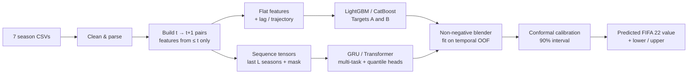

ī# ⚽ FIFA Player Value Forecasting

**Predict a player's market value for next season, with a calibrated 90% prediction interval.**

A hybrid ensemble of gradient-boosted trees and a sequence neural network, trained on seven seasons of FIFA Career Mode data (FIFA 15 → FIFA 21). It forecasts the FIFA 22 value of every player in the FIFA 21 dataset.

> **Status:** project scaffold and specification. Results tables below are intentionally blank (`—`) until you run the pipeline. No numbers in this README are estimates.

---

## Table of contents

1. [Why this project](#why-this-project)
2. [The data](#the-data)
3. [Approach](#approach)
4. [Results](#results)
5. [Quickstart](#quickstart)
6. [Repository structure](#repository-structure)
7. [Validation protocol](#validation-protocol)
8. [Prediction intervals](#prediction-intervals)
9. [Explainability](#explainability)
10. [Limitations](#limitations)ī
11. [Roadmap](#roadmap)

---

## Why this project

Player value drives transfer-market gameplay in Career Mode, squad-building balance, and in-game economy tuning. Given a player's attributes and history through season **t**, this project estimates their value in season **t+1** and says how uncertain that estimate is.

Two framings are built and compared head-to-head:

| Target | Definition | Intuition |
|---|---|---|
| **A: Level** | `log1p(value_{t+1})` | Predict the next value directly |
| **B: Growth** | `log1p(value_{t+1}) − log1p(value_t)` | Predict the *change* from today's value |

Both are converted back to euros and scored on the same rows, so the comparison is fair.

---

## The data

Input: `archive.zip` with one CSV per game edition.

| Season | File | Players |
|---|---|---|
| 2015 | `players_15.csv` | 16,155 |
| 2016 | `players_16.csv` | 15,623 |
| 2017 | `players_17.csv` | 17,597 |
| 2018 | `players_18.csv` | 17,954 |
| 2019 | `players_19.csv` | 18,085 |
| 2020 | `players_20.csv` | 18,483 |
| 2021 | `players_21.csv` | 18,944 |

The zip also includes an `.xlsx` with the same data (one sheet per season). The pipeline ignores it.

**Things worth knowing up front**

- 106 columns, identical across all seasons, joined on `sofifa_id`.
- ~74k labeled *(season t → t+1)* pairs. Only **4,031** players appear in all seven seasons, so most histories are short and the models must handle variable-length history.
- `value_eur` is heavily skewed (FIFA 21: median €650k, max €105.5M), so everything is modeled in log space.
- ~237 players in FIFA 21 have `value_eur = 0`; almost all are club-less with `wage_eur = 0`. They are excluded from targets and flagged as inputs.
- `release_clause_eur` doesn't exist in FIFA 15; goalkeeper skill columns are ~89% empty by design; `defending_marking` is empty in FIFA 21.
- There is no FIFA 22 file: the final forecast has no ground truth to check against.

---

## Approach



**1. Feature engineering.** Parsed position ratings (`"85+3"` → 88), contract years remaining, tenure, work-rate split, position groups, trait/tag counts, plus backward-looking trajectory features: lags, deltas, rolling means, slopes, seasons-since-peak, and potential gap.

**2. Drift handling.** EA's valuation scale shifts between editions. Instead of feeding raw `season` to the models, features are normalized per season (percentile ranks, league and position-group medians), so the models can still generalize to 2022.

**3. Baselines first.** Persistence (`value_{t+1} = value_t`), segment-median growth, and Ridge. Every model is reported against these.

**4. Tabular branch.** LightGBM and CatBoost on both targets, tuned with Optuna under temporal cross-validation.

**5. Sequence branch.** A GRU (optionally a small Transformer) over each player's last *L* seasons with masking, categorical embeddings, a multi-task head for both targets, and quantile heads for uncertainty.

**6. Blender.** A non-negative linear combiner fit on out-of-fold predictions from the temporal folds.

**7. Intervals.** Quantile models plus Conformalized Quantile Regression, targeting 90% coverage.

---

## Results

Held-out test transition: **2020 → 2021** (touched once, at the end). All metrics are in euro space on the same rows.

| Model | Target | RMSLE ↓ | MAE (€) ↓ | Median AE (€) ↓ | Within ±25% ↑ | Spearman ↑ |
|---|---|---|---|---|---|---|
| Persistence | — | 0.5448 | €1,047,600 | €250,000 | 44.9% | 0.9126 |
| Segment-median growth | — | 0.5069 | €961,536 | €260,000 | 42.5% | 0.9188 |
| Ridge | A | 0.5092 | €965,738 | €313,535 | 37.6% | 0.9206 |
| LightGBM (Target A) | A | 0.7954 | €1,910,899 | €390,307 | 27.2% | 0.8553 |
| LightGBM (Target B) | B | 0.5614 | €1,263,961 | €352,105 | 34.6% | 0.9117 |
| CatBoost (Target A) | A | 0.7113 | €1,723,716 | €338,685 | 29.9% | 0.8931 |
| CatBoost (Target B) | B | 0.5676 | €1,372,596 | €335,597 | 31.8% | 0.9152 |
| Sequence NN | A+B | 13.7704 | €2,960,578 | €900,000 | 0.0% | 0.5135 |
| Hybrid ensemble | blend | 0.5676 | €1,372,596 | €335,597 | 31.8% | 0.9152 |

**Interval quality (nominal 90%)**

| Overall coverage | Mean width (log) | Winkler score |
|---|---|---|
| 94.59% | 4.3587 | 4.8732 |

Results tables are generated by `make evaluate` into `reports/metrics/`. Paste the final numbers here.

---

## Quickstart

**Requirements:** Python 3.11+, ~8 GB RAM. A GPU is optional (the sequence model is small).

```bash
# 1. Clone and set up
git clone <your-repo-url> fifa-value-forecast && cd fifa-value-forecast
python -m venv .venv && source .venv/bin/activate
pip install -e ".[dev]"

# 2. Put the dataset where the pipeline expects it
cp /path/to/archive.zip data/archive.zip

# 3. Run the pipeline
make data       # unzip CSVs → data/raw/, validate schema
make features   # clean, parse, build t → t+1 pairs and sequences
make train      # baselines, GBMs, sequence NN, blender, conformal calibration
make evaluate   # metrics, slices, A-vs-B comparison, plots → reports/
make predict    # FIFA 22 forecasts → outputs/predictions_2022.csv

# Quality checks
make test       # unit tests incl. the no-future-leakage test
make lint
```

**Output file** (`outputs/predictions_2022.csv`):

| Column | Meaning |
|---|---|
| `sofifa_id`, `short_name`, `age`, `club_name` | Player identity |
| `value_2021` | Current value (€) |
| `pred_value_2022` | Forecast median value (€) |
| `lower_90`, `upper_90` | 90% prediction interval (€) |
| `pred_change_pct` | Forecast change vs current value |

---

## Repository structure

```
fifa-value-forecast/
├── configs/            # YAML configs: base, lgbm, catboost, seq, blend
├── data/               # raw / interim / processed (gitignored)
├── notebooks/          # 01_eda.ipynb
├── src/fifa_value/
│   ├── data/           # load, clean, pair builder
│   ├── features/       # engineering, encoders, sequence builder
│   ├── models/         # baselines, GBMs, sequence NN, blender, conformal
│   ├── eval/           # metrics, temporal CV, slices, reports
│   └── cli.py
├── tests/              # leakage, parsers, metrics, shapes
├── reports/            # eda, metrics, figures
├── outputs/            # predictions + model artifacts
└── docs/               # DECISIONS.md, MODEL_CARD.md
```

---

## Validation protocol

All validation is **temporal**. Random splits would let the same player's adjacent seasons straddle train and test, which overstates accuracy.

| Fold | Train transitions | Validate |
|---|---|---|
| 1 | 15→16, 16→17 | 17→18 |
| 2 | 15→16 … 17→18 | 18→19 |
| 3 | 15→16 … 18→19 | 19→20 |
| **Test** | 15→16 … 19→20 | **20→21** |

Leakage guardrails:

- Features for `(player, t)` use seasons ≤ t only. A unit test enforces this.
- Scalers, imputers, and encoders are fit on training folds only.
- Zero-value rows are excluded from the primary evaluation (with a sensitivity check).
- Metrics are reported per fold, so you can see variance, not just the mean.

---

## Prediction intervals

Point forecasts alone hide risk: a 19-year-old with high potential is far less predictable than a 28-year-old at his peak. The pipeline produces a **90% interval** by:

1. Training quantile models (q05 / q50 / q95).
2. Applying **Conformalized Quantile Regression** on a calibration transition to correct over- or under-confident bands.
3. Reporting coverage and width overall and by value tier, age band, position group, and history length.

Target: empirical coverage between 88% and 92% on the test transition. Segments that miss this are called out in the evaluation report.

---

## Explainability

- **SHAP** summary and dependence plots for the tabular models (age, overall, potential gap, contract years remaining).
- **Error analysis** on the 50 largest euro-space misses.
- **Sanity checks** on the 2022 forecasts: top predicted risers and fallers, and age-curve plausibility.

---

## Limitations

- **EA's value ≠ the real transfer market.** The model learns how EA's valuation responds to ratings, age, contract, and reputation, not real-world fees.
- **Survivorship bias.** Players who disappear from the next edition have no label, so the model only forecasts players who remain in the game.
- **Scale drift between editions.** Mitigated by per-season normalization, but not eliminated. Check the 2022 forecast distribution against recent seasons before using it.
- **Unlicensed / zero-value entries** are excluded from training and evaluation.
- **Short histories.** Most players have only a few seasons, so trajectory features are often partly missing.
- **No ground truth for 2022.** The final forecast is validated only through the 2020 → 2021 backtest.

---

## Roadmap

- [ ] Player embeddings learned across seasons (cold-start helpers for rookies)
- [ ] Monotonic constraints on `overall` and `potential` for the GBMs
- [ ] Club-level and league-level market context features
- [ ] Multi-horizon forecasts (t+2, t+3) with widening intervals
- [ ] Lightweight API / Streamlit dashboard for scouting what-ifs

---

## License

Choose a license for your code (e.g. MIT). Check EA Sports' terms for the source data before redistributing it; this repo should not commit the raw CSVs.
